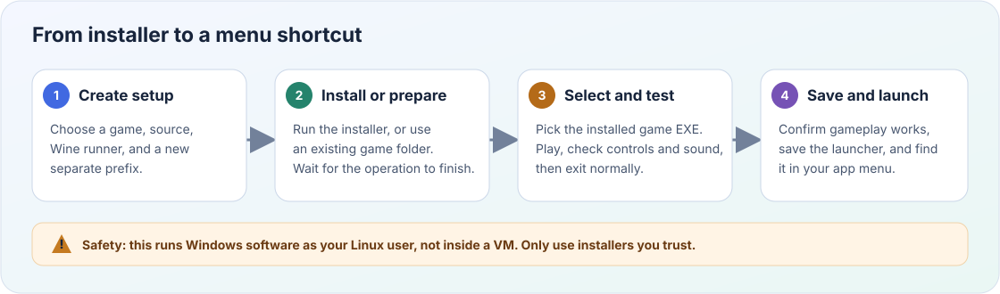
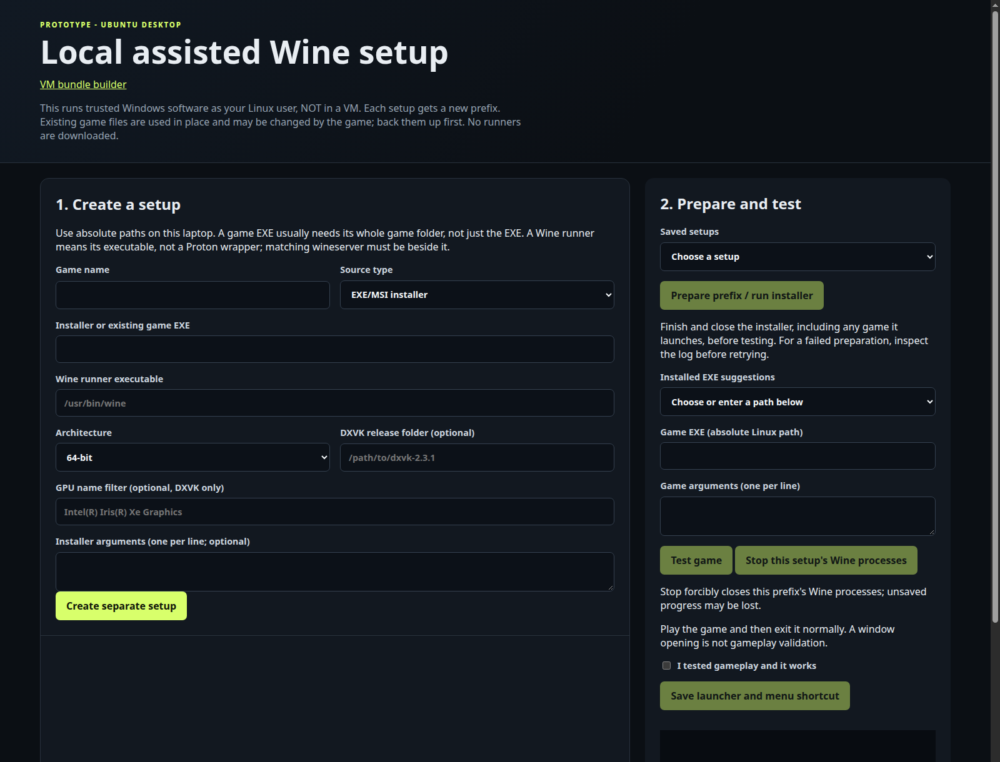
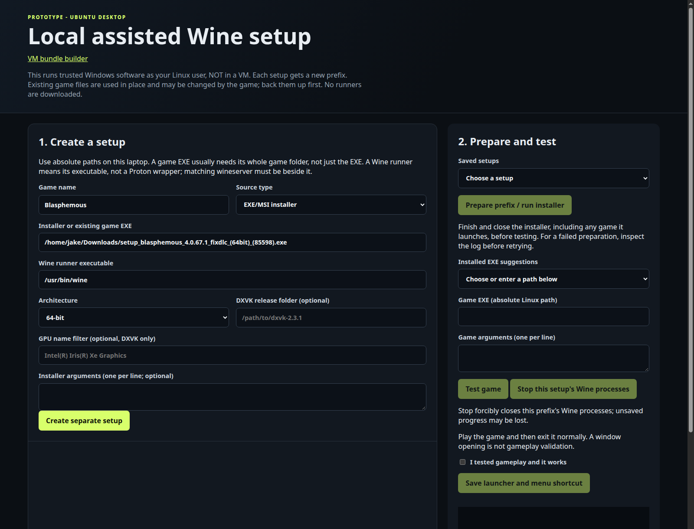
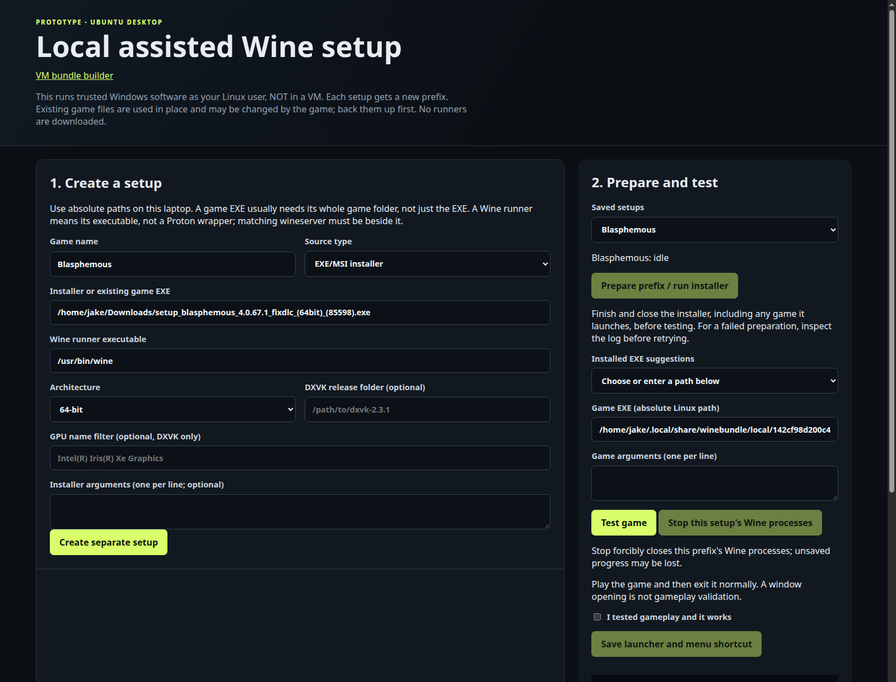

# Install a game with local assisted setup

This walkthrough uses Blasphemous as an example. Blazing Chrome was installed
with the same workflow. For another game, substitute its name, installer path,
and installed game executable.

This is the **local assisted setup** workflow, not the VM bundle builder.
It runs Windows software on your desktop using Wine and gives each setup a
separate prefix (a directory containing its Windows environment). It does not
isolate software from your Linux account: only run installers you trust.

## At a glance



**Quick checklist**

- Have a trusted installer or an already-installed game, plus a Wine runner.
- Create a separate setup and wait for Wine to finish preparing it.
- Select the installed game executable and test real gameplay.
- Save the launcher only after gameplay works.

> **Important:** This workflow is not a VM and does not sandbox installers or
> games from your Linux account. Back up existing game files and saves first.

## On this page

- [Open the tool](#1-open-the-tool)
- [Create a separate setup](#2-create-a-separate-setup)
- [Prepare the prefix and install](#3-prepare-the-prefix-and-install)
- [Select the actual game EXE](#4-select-the-actual-game-exe)
- [Play-test, then save](#5-play-test-then-save)
- [Launch later or add to Momentum Core](#6-launch-later-or-add-to-momentum-core)
- [Troubleshooting](#if-something-goes-wrong)

## 1. Open the tool

If the GUI is already running, open <http://127.0.0.1:8765/local>. Do not start a
second server against the same setups.

Otherwise, open a terminal and run:

```bash
cd /home/jake/Projects/GamesRepo/winebundle-orchestrator
python3 gui/winebundle_gui.py
```

The browser opens **Your games**, the game library. Select **Add game** to
start the guided setup. The `/local` address opens the same library.
Keep the terminal and server running while installing, testing, or playing
through the GUI. The separate VM builder is available under
**Advanced: VM bundle builder** at `/builder`.

On first run, the tool opens **System check**. It confirms Wine, 32-bit
support, graphics drivers, and Vulkan, and gives copyable install commands for
anything missing. On this machine, everything is reported as **OK**: Wine 9.0
at `/usr/bin/wine` with its matching `/usr/bin/wineserver`. You can reopen it
from **System check** in the header at any time.

The tool does not install packages or download Wine runners. If you choose a
different runner, its matching `wineserver` must be beside it. Do not select a
Proton wrapper.

The wizard shows one step at a time: **Choose game**, **Install**, **Test**,
and **Finish**. Controls stay disabled until their prerequisites are complete.
Return to the library at any time and use **Continue setup** to resume.

The screenshots below show the earlier two-panel prototype. Paths and Wine
behavior remain the same; follow the current button names in the text.



## 2. Create a separate setup

Select **Add game** and enter:

| Field | Blasphemous example |
|---|---|
| Game name | `Blasphemous` |
| What are you adding? | `EXE/MSI installer` |
| Installer file | Choose `setup_blasphemous_4.0.67.1_fixdlc_(64bit)_(85598).exe` from Downloads with **Browse...** |
| Wine executable | `/usr/bin/wine` (prefilled) |
| Architecture | `64-bit` |
| DXVK release folder | Leave blank for this first attempt |
| GPU name filter | Leave blank |
| Installer arguments | Leave blank for an interactive installer |

Architecture, DXVK, GPU filtering, and installer arguments are under
**Compatibility and installer options**. The earlier form below is filled
with the Blasphemous example values from the table.
Replace the installer path with the file on your computer.



**Browse...** opens the app's own file browser, which shows only folders and
matching files (installers, EXEs, or programs) and remembers the last folder
you used. The Wine executable is prefilled with `/usr/bin/wine` when it and
its `wineserver` are installed; the status under it confirms this. To use a
different Wine build, browse to its `bin/wine`.

You can also type paths **without surrounding quotes**, even when they contain
spaces or parentheses. Use complete Linux paths, not `~`.

Click **Continue to installation**. This saves a separate setup; the prefix
is initialized in the next step. For an existing setup, use **Continue setup**
in the library instead of creating another copy.

For other games, choose the architecture appropriate to the installer and game.
Do not assume that an installer being 32-bit means the game needs a 32-bit
prefix; 64-bit prefixes can also run 32-bit programs when Wine's required
32-bit support is installed.

## 3. Prepare the prefix and install

Click **Prepare and open installer** (or **Prepare Wine environment** for an
already-installed game).

1. Wait for Wine to initialize the new prefix.
2. Complete the installer window that appears on your desktop.
3. Use the default installation directory unless you have a reason to change it.
4. If the installer offers to launch the game, uncheck that option if possible.
5. Finish and close the installer. If it opened the game, close that too.
6. Wait for the browser to report preparation finished and advance to **Test**.

Only one local operation can run at a time. Do not start testing while
preparation is still running.

## 4. Select the actual game EXE

Use **Detected games**, or select **Browse...** next to **Game executable**.
The browser opens at the game's C: drive and shows Windows-style paths such
as `C:\GOG Games\Blasphemous\Blasphemous.exe`. You can also type a `C:\...`
path, or an absolute Linux path for a game outside the prefix.

Choose the game executable, **not** the downloaded installer, an uninstaller
such as `unins000.exe`, or a Wine component such as `iexplore.exe`.

The suggestions scan the prefix's C: drive, including Program Files,
`C:\GOG Games`, `C:\Games`, and AppData, but skip Windows system directories
and directory symlinks to locations outside the prefix. Likely game executables
are listed ahead of installers, uninstallers, and common helper programs.
A clear match fills an empty **Game executable** field automatically; it never replaces
a path you have already entered or saved. Ambiguous matches require you to
choose. Detection is heuristic, so always check the path and test gameplay.
For games installed outside the prefix, browse to them or enter their Linux path.
For an already-installed game setup, the original source EXE is also suggested.

For this Blasphemous setup (created before readable folder names, so it keeps
its hexadecimal folder), the prefix is:

```text
/home/jake/.local/share/winebundle/local/142cf98d200c47b9b2cab142c13b148f/prefix
```

The game executable, shown in the app as
`C:\GOG Games\Blasphemous\Blasphemous.exe`, is this Linux file:

```text
/home/jake/.local/share/winebundle/local/142cf98d200c47b9b2cab142c13b148f/prefix/drive_c/GOG Games/Blasphemous/Blasphemous.exe
```

To find executables in its GOG Games folder:

```bash
find '/home/jake/.local/share/winebundle/local/142cf98d200c47b9b2cab142c13b148f/prefix/drive_c/GOG Games' \
  -type f -iname '*.exe'
```

For a different setup, open **Setup & details** and expand **Technical
details** to see its folder and prefix paths. New setups use a readable folder
name based on the game name, such as `blasphemous`.

The Windows directory `C:\GOG Games` maps to `prefix/drive_c/GOG Games` on
Linux. The tool automatically uses the selected EXE's parent folder as the
game's working directory. Expand **Launch arguments** if needed; leave
**Game arguments** blank unless the game needs specific options.

After preparation, continue to the **Test** step. The earlier screenshot shows this machine's
prepared Blasphemous setup with its game EXE filled in and **Test game** ready.
Your setup name and path will be different. The GOG path should now appear in
**Detected games**, but you can still browse to it.



## 5. Play-test, then save

1. Click **Test game**.
2. Enter actual gameplay, rather than only checking the title screen.
3. Check graphics, sound, keyboard/controller input, and saving if practical.
4. Quit the game normally and wait for the test process to finish.
5. On the **Finish** step, if it worked, check **I tested gameplay and it works**.
6. Under **Shortcuts**, keep **Application menu** selected and, if you like,
   select **Desktop**.
7. Click **Save game**.

An installer finishing or a game exiting with code zero is not proof that
gameplay works. Only confirm the checkbox after testing it yourself.

The save button requires a successfully completed test in the current server
session. After restarting the GUI, test again before saving a new shortcut.
Changing the EXE or arguments also requires another test.

## 6. Launch later or add to Momentum Core

After saving, select **Play** in the game library, or search your application
menu for **Blasphemous** (or double-click its desktop icon, if you added one).
Library Play remains available after restarting the
GUI and does not require another setup test. Saved menu and desktop
shortcuts work without the GUI or its server running.

To add or remove shortcuts later, open **Setup & details** for the game and
change the **Shortcuts** checkboxes on the Finish step. Changes apply
immediately and don't require another test. This also works for games saved
before desktop shortcuts were available.

Each setup keeps these files in `~/.local/share/winebundle/local/<id>/`,
where `<id>` is the readable folder name (or a hexadecimal ID for older setups):

| File or directory | Purpose |
|---|---|
| `prefix/` | Installed game and its Windows environment |
| `setup.json` | Saved setup settings and launcher paths |
| `activity.log` | Preparation and test output |
| `play.sh` | Saved launch script, created after you accept the play test |

The desktop entry is saved as
`~/.local/share/applications/winebundle-<id>.desktop` by default. If
`XDG_DATA_HOME` is set, its `applications` directory is used instead. A
desktop shortcut uses the same file name in your desktop folder (normally
`~/Desktop`).

For this setup, the saved desktop entry is:

```text
/home/jake/.local/share/applications/winebundle-142cf98d200c47b9b2cab142c13b148f.desktop
```

If Momentum Core supports importing `.desktop` files, select that file. If it
instead accepts a launch executable/script, select:

```text
/home/jake/.local/share/winebundle/local/142cf98d200c47b9b2cab142c13b148f/play.sh
```

These are launcher inputs, not an instruction to select the Windows EXE
directly: the script sets the correct Wine prefix and working directory.
Keep the runner, game, and prefix at their recorded paths.

## If something goes wrong

- **No installer window:** check the page's log and status. Wine initialization
  can take a little time. Look for an error before retrying.
- **Preparation is still running:** close any installer, game, or remaining
  Wine dialog. The tool waits for this prefix's Wine processes to exit.
- **Game missing from suggestions:** use **Browse...** next to **Game
  executable**; it opens at the prefix's C: drive (try `C:\GOG Games`).
- **Game fails or has broken graphics/audio:** open **System check** first and
  resolve any **Recommended** items, such as missing 32-bit Wine or Vulkan
  support. Keep the error and
  `activity.log`. Do not mark gameplay as working. The prototype does not
  automatically install missing dependencies or repair compatibility.
- **Need to stop a hung operation:** use **Stop this setup's Wine processes**.
  This forcibly closes that setup's Wine processes and can lose unsaved progress.
- **Want another runner or DXVK settings:** create a new setup for the
  experiment. The optional DXVK input expects an extracted release directory,
  not an archive, and this prototype only installs its Direct3D 11
  `d3d11.dll` and `dxgi.dll`. DXVK also needs a compatible Vulkan stack.

Do not delete an existing prefix to troubleshoot without backing up game saves.
The tool does not freeze or bundle the Wine runner, so a system Wine update can
change compatibility later.
