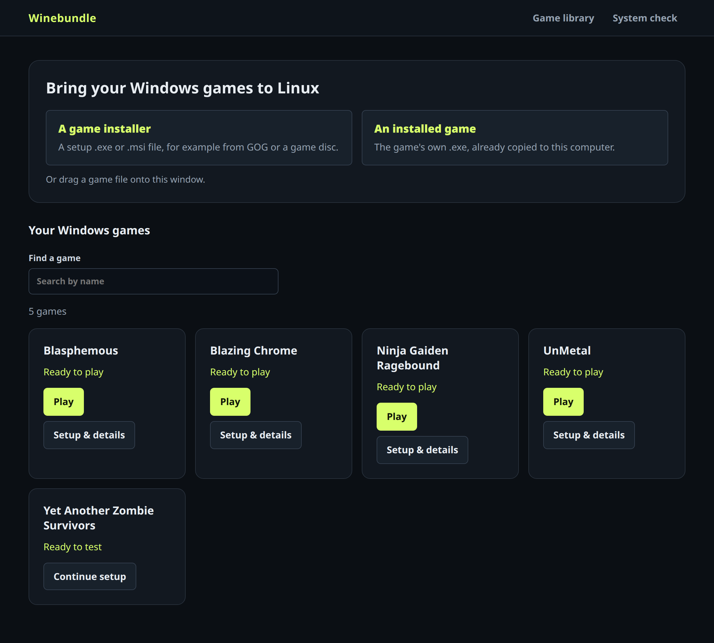
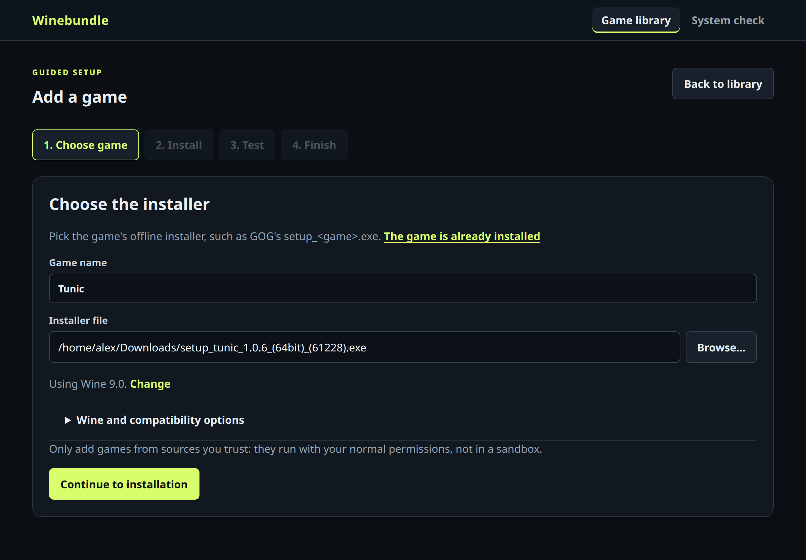
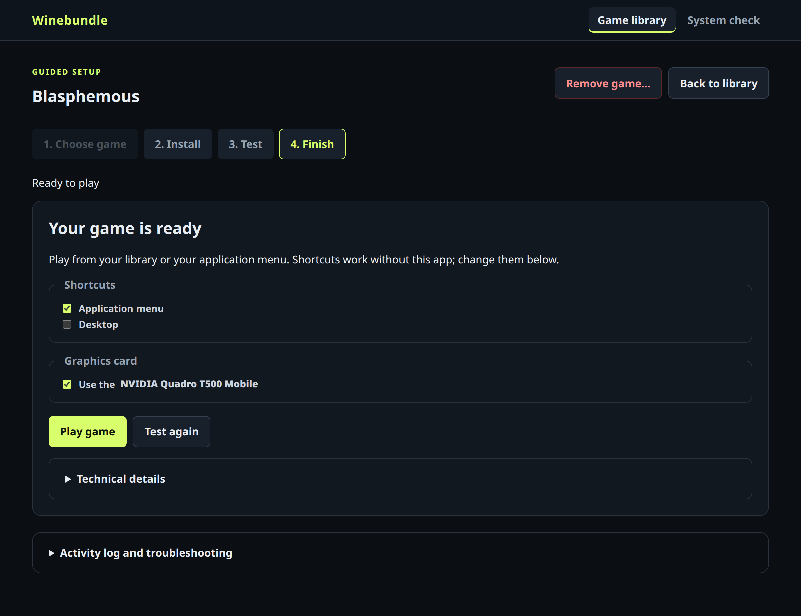
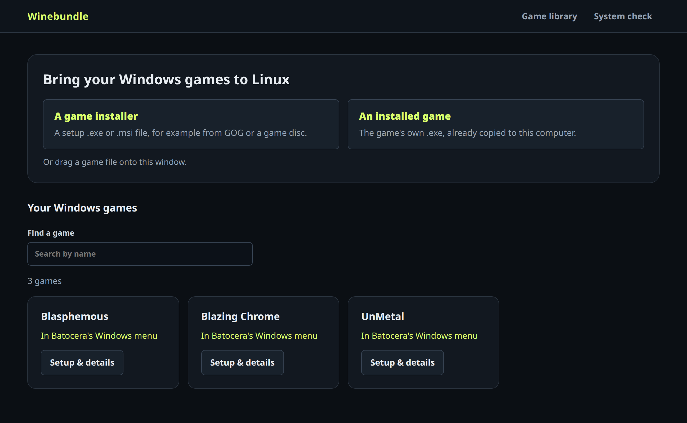
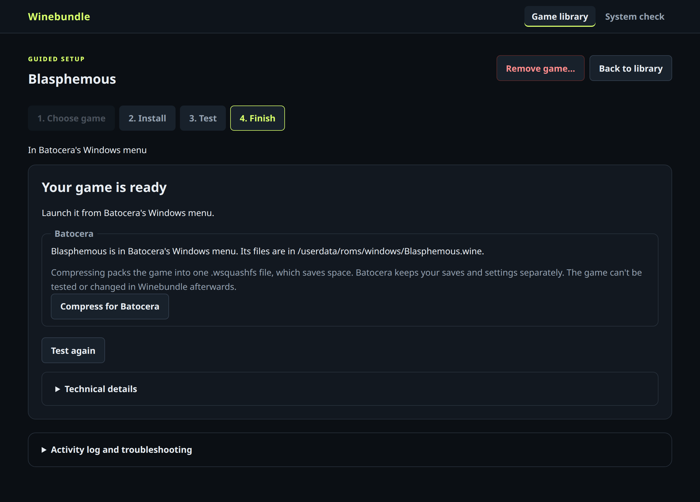

<p align="center">
  
</p>

<h1 align="center">Winebundle</h1>

<p align="center"><strong>Play your Windows games on Linux, without the terminal.</strong></p>

<p align="center">
  <a href="#winebundle-for-ubuntu">Ubuntu</a> ·
  <a href="#winebundle-for-batocera">Batocera</a> ·
  <a href="https://github.com/jacobm36/winebundle-orchestrator/releases">Releases</a>
</p>

Getting a Windows game running on Linux usually means Wine prefixes, terminal commands,
and hand-written launchers. Winebundle does that for you. Pick the game's installer,
click through it like you would on Windows, try the game, and it's added to your
application menu (or, on Batocera, to the **Windows** menu) ready to play.



## Why Winebundle

- **No terminal needed.** A guided four-step setup (choose, install, test, finish) takes
  you from an installer to a working game.
- **Each game gets its own Wine setup.** A game that needs special settings can't break
  your other games, and removing a game cleans up its Wine setup and shortcuts.
- **Only saves games you've tested.** You play the game before it's saved, so what you
  find in your menu is something you know runs.
- **Your games work without Winebundle open.** Each game gets an ordinary menu or desktop
  shortcut (Ubuntu) or a normal entry in Batocera's Windows menu.
- **It checks your computer first.** **System check** finds what's missing, such as
  Wine, 32-bit support or Vulkan drivers, and shows the exact command to fix it.
- **It knows about game installers.** Names are filled in from files like GOG's
  `setup_<game>.exe`, the game's `.exe` is found after installing, and web installers that
  won't work (such as GOG Galaxy or Steam) are caught early.
- **It handles laptop graphics.** On laptops with two graphics cards, games use the faster
  card automatically.

Winebundle is free and open source under the [MIT License](LICENSE).

## Winebundle for Ubuntu

For Ubuntu and other Debian-based desktops. Download `winebundle_<version>_all.deb` from
the newest [Winebundle for Ubuntu release](https://github.com/jacobm36/winebundle-orchestrator/releases?q=ubuntu&expanded=true),
then install it, along with Wine and everything else it needs:

```bash
sudo apt install ~/Downloads/winebundle_*_all.deb
```

Open **Winebundle** from your application menu.

<table>
  <tr>
    <td width="50%"></td>
    <td width="50%"></td>
  </tr>
  <tr>
    <td align="center">Pick an installer; the name and Wine are filled in.</td>
    <td align="center">Choose shortcuts once the game is tested.</td>
  </tr>
</table>

**[Read the Ubuntu guide →](docs/UBUNTU.md)** It covers running from source, the system
check and every step of setting up a game. There's also a
[walkthrough with a real game](LOCAL-SETUP-TUTORIAL.md).

## Winebundle for Batocera

For [Batocera](https://batocera.org) 43 on x86 PCs. Install games right on the Batocera
machine and play them from its **Windows** menu with a controller. You don't need
another computer or a config file.

On the Batocera machine (F1 → Applications → xterm, or over SSH), run:

```sh
curl -fsSL https://raw.githubusercontent.com/jacobm36/winebundle-orchestrator/master/packaging/batocera/get-winebundle.sh | sh
```

Then open **Winebundle** from **F1 → Applications** or **Ports**. Run the command again
to update.

<table>
  <tr>
    <td width="50%"></td>
    <td width="50%"></td>
  </tr>
  <tr>
    <td align="center">Games go straight into Batocera's Windows menu.</td>
    <td align="center">Compress a finished game to a single <code>.wsquashfs</code>.</td>
  </tr>
</table>

**[Read the Batocera guide →](docs/BATOCERA.md)** It covers controller buttons, Wine
versions, compressing games and uninstalling.

## Good to know

- Winebundle needs a game's **offline installer**, such as GOG's `setup_<game>.exe`, or
  a game that's already installed. Store launchers like Steam aren't supported.
- Not every Windows game runs under Wine. The test step lets you find out before
  anything is saved. [ProtonDB](https://www.protondb.com) and
  [WineHQ's database](https://appdb.winehq.org) are good places to check first.
- Wine isn't a sandbox: games run with your normal permissions, so only install games
  from sources you trust.

## For developers

The repository also contains the **VM bundle builder**, a command-line tool that builds
and validates portable Wine prefixes inside a disposable VM. See
[docs/BUNDLE-BUILDER.md](docs/BUNDLE-BUILDER.md).

Run the tests from the repository root:

```bash
make test
```

Ubuntu and Batocera are released separately from the same code. Ubuntu releases are
tagged `ubuntu-v<version>` and include the `.deb`. Batocera releases are tagged
`batocera-v<version>`, and the Batocera install command picks the newest one. To publish,
update `VERSION`, commit, then run `make release-ubuntu`, `make release-batocera`, or
`make release` for both (needs the `gh` CLI). The text at the top of each release comes
from [packaging/release-notes](packaging/release-notes).

## License

Winebundle is released under the [MIT License](LICENSE). Copyright Momentum Studios.
