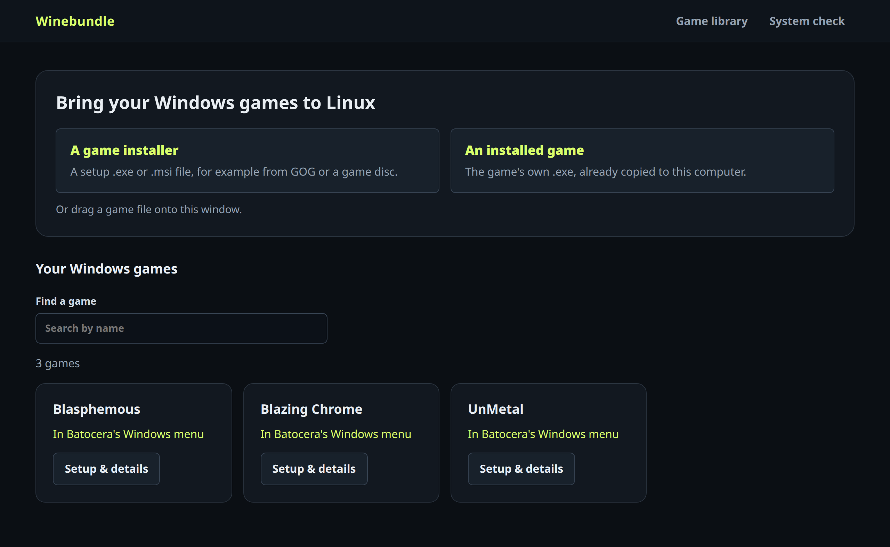
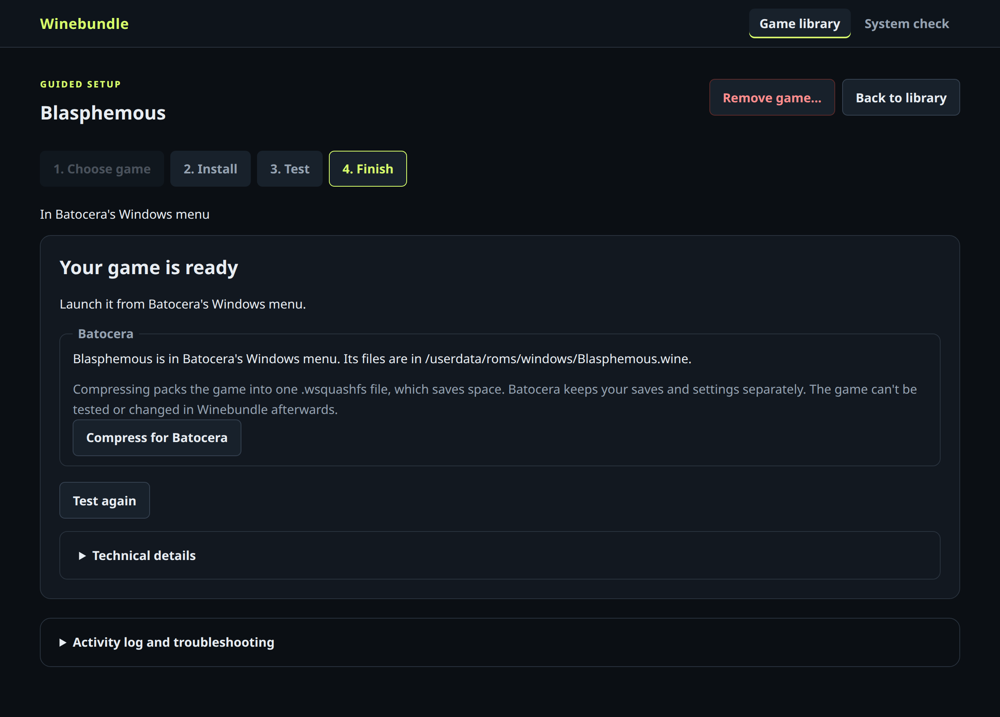

# Winebundle for Batocera

Winebundle installs Windows games right on your [Batocera](https://batocera.org) machine.
Pick a game's installer, click through it, try the game, and it appears in Batocera's
**Windows** menu, ready to play with a controller. You don't need another computer, and
you don't have to edit `autorun.cmd` or `batocera.conf` yourself. See the
[README](../README.md) for an overview.



## Install

You need Batocera 43 (tested on 43.1) on an x86 PC, connected to the internet. On the
Batocera machine, open **F1 → Applications → xterm**, or connect over SSH
(`ssh root@batocera.local`, password `linux`), and run:

```sh
curl -fsSL https://raw.githubusercontent.com/jacobm36/winebundle-orchestrator/master/packaging/batocera/get-winebundle.sh | sh
```

This installs the newest Winebundle for Batocera into `/userdata/system/winebundle` and
adds it to **F1 → Applications** and the **Ports** menu. Run the same command again to
update; your games and settings are kept. To install a particular release, put
`WINEBUNDLE_VERSION=0.1.0` before `sh`.

## Open Winebundle

- **F1 → Applications → Winebundle** is best with a keyboard and mouse.
- **Ports → Winebundle** works with a controller: the D-pad moves between controls, A
  selects, B goes back, the left stick moves the mouse pointer, R2 clicks, and
  **Hotkey + Start** closes Winebundle.

The window fills the screen and has a **Quit** button in its header.

## Add a game

1. Copy the game's offline installer (for example GOG's `setup_<game>.exe`) to
   `/userdata/roms/windows_installers/` over the network share (`\\BATOCERA\share`) or
   from a USB drive. **Browse...** in Winebundle also shows USB drives.
2. Choose **A game installer** (or **An installed game** for a game folder you've
   copied), pick the file, then **Open the installer** and click through it.
3. Pick the game's `.exe`, select **Test the game**, play it, then choose **It works — save game**.

Winebundle installs each game into `/userdata/roms/windows/<Name>.wine/`, writes the
`autorun.cmd` Batocera needs, sets the game's Wine version in Batocera's settings, and
refreshes the game list. The game then shows up in the **Windows** menu.



- **Wine versions:** Winebundle uses Batocera's own Wine builds: `wine-proton` by default,
  `wine-tkg`, or any version you've added to `/userdata/system/wine/custom/`. Choose one
  under **Wine and compatibility options** when adding a game.
- **Compress for Batocera** packs a finished game into a single `.wsquashfs` file to save
  space. Batocera keeps saves and settings separately. A compressed game can't be tested
  or changed in Winebundle afterwards.
- **Graphics card** and launching are left to Batocera: start games from its menu, and
  set the graphics card in Batocera's own settings.
- **Remove game...** takes a game out of the Windows menu and deletes its folder (or its
  compressed file).

## Uninstall

```sh
sh /userdata/system/winebundle/packaging/batocera/uninstall.sh
```

Games you added stay in Batocera's Windows menu and keep working. Winebundle's records of
them are kept, so reinstalling brings them back into its library.

## Troubleshooting

- Winebundle's output is logged to `/userdata/system/logs/winebundle.log`.
- To start it over SSH with a visible mouse pointer:

  ```sh
  ssh -t root@batocera.local 'batocera-mouse show; DISPLAY=:0 python3 /userdata/system/winebundle/gui/winebundle_app.py; batocera-mouse hide'
  ```

  Ctrl+C or Ctrl+Q closes it, and so does
  `python3 /userdata/system/winebundle/gui/winebundle_app.py --quit`.

## For developers

From a checkout on another computer, `make batocera` copies your working copy to
`root@batocera.local` instead of a release (set `BATOCERA=root@<address>` for another
machine). [BATOCERA-PLAN.md](BATOCERA-PLAN.md) has the design notes and test checklist.
