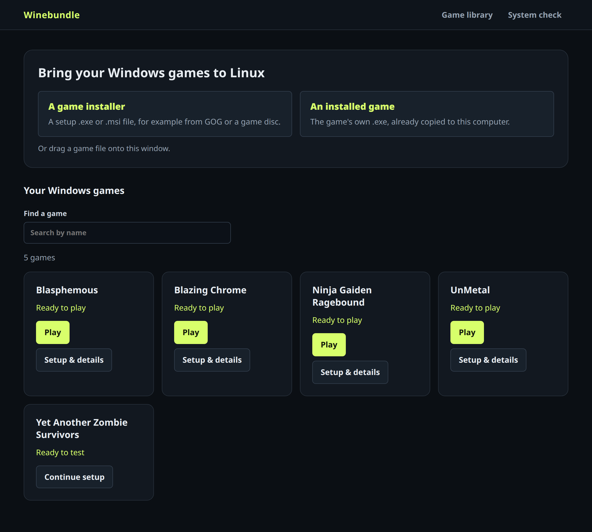
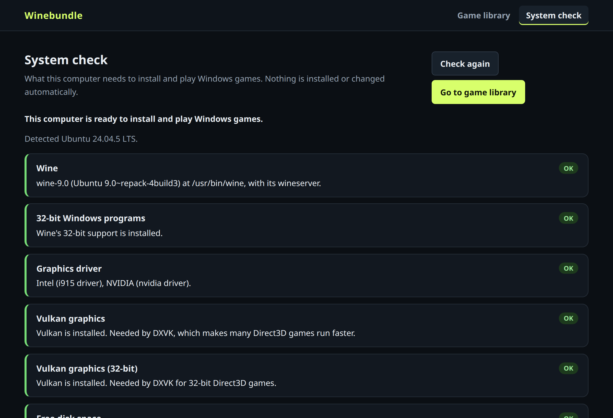
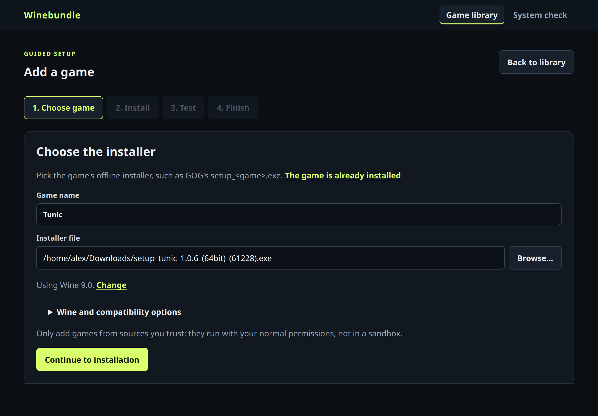
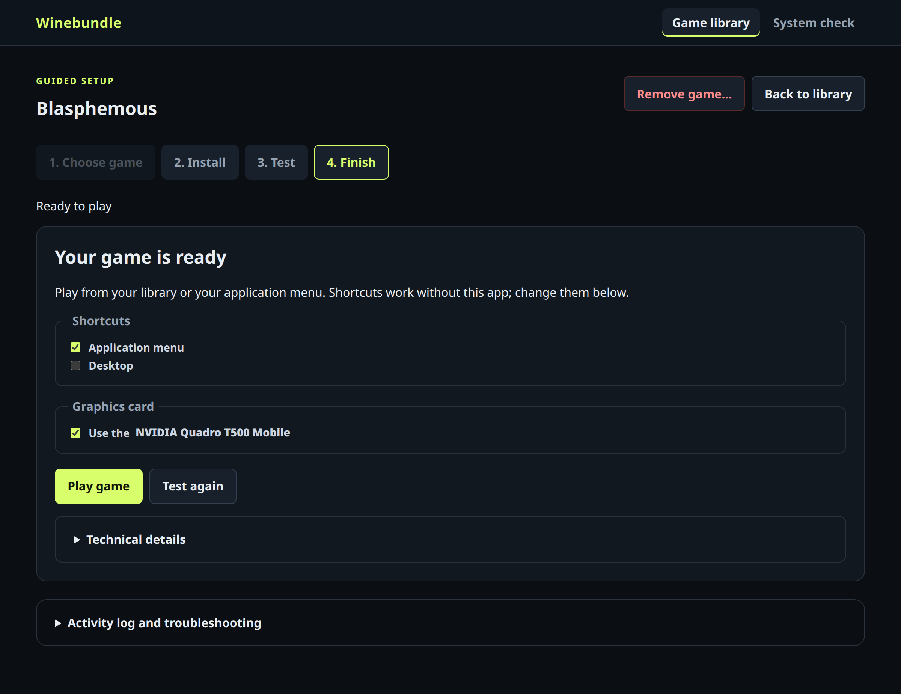

# Winebundle for Ubuntu and other Linux desktops

Winebundle installs your Windows games with Wine and adds them to your application menu,
each in its own separate Wine setup. See the [README](../README.md) for an overview.



## Desktop app

Winebundle runs as a desktop app with its own window.

### Install as a package (Debian and Ubuntu)

Download `winebundle_<version>_all.deb` from the newest
[Winebundle for Ubuntu release](https://github.com/jacobm36/winebundle-orchestrator/releases?q=ubuntu&expanded=true),
then install it with `apt`, which also installs the Python and WebKitGTK packages the
window needs, plus Wine and winetricks:

```bash
sudo apt install ~/Downloads/winebundle_*_all.deb
```

Install a newer release the same way to update. To build the package from a checkout
instead, run `make deb` and install `./dist/winebundle_<version>_all.deb`.

The package puts the app in `/usr/share/winebundle`, the `winebundle` command
in `/usr/bin`, and **Winebundle** in the application menu, so
`make install-menu-entry` isn't needed. If you added a menu entry from a
checkout before, run `make remove-menu-entry` so the menu opens the
installed copy. Wine's 32-bit support (`wine32:i386`) needs the i386
architecture enabled, so **System check** gives those commands if needed.
Remove the package with `sudo apt remove winebundle`. Saved games, their
shortcuts and preferences, kept under your home folder, aren't affected by
installing, upgrading or removing it.

When building it yourself, the version comes from the `VERSION` file. `packaging/build-deb.sh [folder]`
builds into another folder; it needs only `dpkg-deb` and `python3`.

### Run from a checkout

Start it from the repository root:

```bash
bin/winebundle
```

To add **Winebundle** to the application menu (and dock search), run once:

```bash
make install-menu-entry
```

This writes `io.github.jacobm36.Winebundle.desktop` to
`~/.local/share/applications` and its icon to
`~/.local/share/icons/hicolor/scalable/apps`, pointing at this checkout's
`bin/winebundle`. Run it again if you move the repository, and use
`make remove-menu-entry` to remove it. Saved games and their shortcuts are
not affected.

- **One window:** opening Winebundle again (from the menu or a terminal)
  brings the existing window forward instead of starting a second copy.
- **Closing:** closing the window or pressing `Ctrl+Q` quits immediately when
  nothing is running. Games started with **Play** keep running. If an install
  or test is still running, Winebundle asks first, because closing loses that
  step's result (the installer or game itself keeps running).
- **Without a title bar** (Batocera, or a plain window manager with no desktop
  environment): Winebundle opens maximized and shows a **Quit** button in its
  header. From a terminal, `bin/winebundle --quit` closes the open window, and
  `Ctrl+C` in the terminal that started it works too. These close without
  asking, and games keep running.
- **Requirements:** the window uses WebKitGTK through PyGObject (on
  Debian/Ubuntu, `python3-gi` and `gir1.2-webkit-6.0`; WebKitGTK 4.1 also
  works). Without them, Winebundle opens in your web browser instead, and
  **System check** shows the install command under **App window**. Use
  `bin/winebundle --browser` to choose the browser deliberately.
- **WebKit sandbox:** Ubuntu 24.04 restricts the unprivileged user namespaces
  WebKit's sandbox needs (`kernel.apparmor_restrict_unprivileged_userns=1`)
  unless a `bwrap-userns-restrict` AppArmor profile is installed. On such
  systems only, Winebundle starts WebKit with its sandbox disabled. The window
  loads nothing but Winebundle's own loopback page, under a strict content
  security policy; any other link opens in your web browser.

The app runs the same local server as the web GUI, in-process, on a random
loopback port. Preferences such as the first-run flag and the last folder used
by each **Browse...** field are stored in
`~/.local/share/winebundle/local/preferences.json`, so they survive restarts
and are shared with the web GUI.

## Game library and guided local setup

For a worked desktop installation example, see the
[local setup tutorial](../LOCAL-SETUP-TUTORIAL.md).

Open the [desktop app](#desktop-app) (or the [web GUI](#local-web-gui)) to
see the home screen. It leads with **Bring your Windows games to Linux**:
choose **A game installer** (setup `.exe`/`.msi`) or **An installed game** (the
game's own `.exe`) to start the guided setup. **Your Windows games**, the library with
**Play** and setup details for each game, is listed below it. `/local` remains
an alias. The app bar has two sections: **Game library** and **System check**.
The VM bundle builder is a developer tool, not part of the app; see
[Local web GUI](#local-web-gui). The [VM builder](BUNDLE-BUILDER.md) and version 1 bundle
configuration format are unchanged.

### Getting started

The first time Winebundle opens, and whenever the library has no games, it
shows **Getting started**, a three-step guide:

1. **Check this computer** runs the System check below and lists only what
   needs attention, with copyable install commands.
2. **Add your first game** asks whether you have a game installer (setup
   `.exe`/`.msi`) or an already installed game `.exe`, and opens the guided
   setup with that choice made. These buttons stay disabled until anything
   **Required** (such as Wine) is installed.
3. **Test, save and play** explains what happens next.

**Skip to game library** leaves the guide; an empty library links back to it.
Once a game has been added, Winebundle opens to the library instead.

### System check



**System check** (in the header) reports what this computer has for running
Windows games. It opens automatically when Wine is missing and the library
already has games. It checks Wine and its version, Wine's 32-bit support (classic or
WoW64), the GPU driver, 64-bit and 32-bit Vulkan (needed for DXVK), free disk
space, menu/desktop shortcut support, the optional winetricks, and whether
WebKitGTK is available for the app window. Problems
appear as **Required**, **Recommended**, or **Optional**, with install commands
for Debian/Ubuntu, Fedora, Arch, or openSUSE that you can copy and run.

The check is read-only: it never installs packages or asks for your password.
It reads system files and runs only `wine --version`. After installing
something, select **Check again**; a newly installed Wine is then prefilled
when you add a game. A banner in the library summarizes any remaining problems.



1. On the home screen, choose **A game installer** (EXE/MSI) or
   **An installed game** (the game's EXE), then name the game. Step 1 keeps
   that choice; its link (**The game is already installed** /
   **I have an installer instead**) switches it. You can also drag the file
   onto the Winebundle window from your file manager: an installer (a `.msi`,
   or an `.exe` that is named like a setup program or built with Inno Setup,
   NSIS or InstallShield) starts an installer setup, and any other `.exe`
   starts an installed-game setup. Dropping a game `.exe` during **Test**
   selects it as the game to test.
2. Use **Browse...** to choose the source file, or type its absolute Linux
   path. The game name is filled in from the file, for example
   **Blasphemous** from GOG's `setup_blasphemous_4.0.67.1_(64bit)_(85598).exe`,
   or from the game's folder for an installed game; a name you've typed is
   never replaced. Below it, a single line such as **Using Wine 9.0.** shows the Wine
   that will be used: `/usr/bin/wine` (or the `wine` on your `PATH`) when its
   matching `wineserver` is in the same directory. Select **Change** to use
   another runner, such as Wine-GE's `bin/wine`; the field is checked as you
   type, without running Wine. If Wine is missing or invalid, the options open
   with the problem shown. Proton's `proton` wrapper is not supported here.
3. Under **Wine and compatibility options**, choose the architecture.
   Optionally provide an extracted DXVK release
   directory with `x64/` and `x32/` DLLs, and a DXVK GPU name filter.
   The prototype installs only `d3d11.dll` and `dxgi.dll`, for Direct3D 11.
4. Continue to installation, then select **Open the installer** (or **Set up
   Wine for this game** for an installed game). Installers appear on your
   desktop; finish and close them (and any games they automatically open).
   The wizard advances to testing when preparation finishes.
5. Select the installed EXE from **Detected games**, browse the prefix's C:
   drive, or type a `C:\...` or absolute Linux path. Detection searches the prefix's C: drive (including GOG Games, Games,
   and AppData), skip Windows system directories and directory symlinks, and
   rank likely game executables ahead of helpers. A clear match fills an empty
   field without replacing your choice. Paths outside the prefix can be browsed
   or entered as Linux paths. The EXE's parent is used as its working directory.
6. Test the game, play it, and exit normally. On the Finish step, choose
   **Shortcuts** (**Application menu** is selected by default; **Desktop** is
   optional), then answer **Did the game work?** with **It works — save game**,
   or **Not yet — test again** to return to testing.



After saving, the same **Shortcuts** checkboxes (in **Setup & details**, on
the Finish step) add or remove the menu and desktop shortcuts immediately,
without another test. Removing shortcuts does not remove the game.

**Graphics card:** on laptops with two graphics cards (such as Intel with
NVIDIA or AMD), games use the more powerful discrete card by default. This
applies to installs, tests, library Play, and the saved `play.sh` launcher, so
menu and desktop shortcuts use it too. Change the default under **Graphics card
for games** on the System check page, or for one game under **Graphics card**
on its Finish step. Winebundle asks `switcheroo-control` which card to use and
what settings it needs, the same way GNOME's "Launch using Discrete Graphics
Card" does. Without it, Winebundle reads `/sys` and uses NVIDIA's PRIME
render offload or Mesa's `DRI_PRIME`. Saved launchers are updated when
Winebundle starts, so they follow driver changes. The option isn't shown on
computers with one graphics card, or on Batocera, where Batocera's own menu
chooses the card and Winebundle leaves its settings alone. The older **GPU name filter** option is
separate: it only tells DXVK which card to use by name.

**Store web installers:** Winebundle needs a game's offline installer.
If the chosen file is a GOG Galaxy web installer (such as
`GOG_Galaxy_<Game>.exe`) or a store app installer (Steam, Epic Games, EA app,
Ubisoft Connect, Battle.net), step 1 explains why it's unlikely to work and
how to get the offline installer (from GOG, the backup `setup_*.exe` download).
GOG Galaxy installers are recognized by name or by the product name inside the
file. To try the file anyway, tick **Use this file anyway**.

**Removing a game:** in **Setup & details** (or **Continue setup**), select
**Remove game...** and confirm. This deletes the game's setup folder: its Wine
environment (with a game installed into it, and any saves or settings stored
there), launcher, and menu and desktop shortcuts. Any Wine processes still
using it are stopped first. The installer file, or an installed game's own
folder, is kept. It isn't available while that game's installer or test is
running.

The library shows each game's setup status. Search by name, use **Continue
setup** to resume an unfinished installation, or **Play** to launch a saved
game with its confirmed executable and arguments. **Setup & details** opens
the setup steps and activity log; full launcher, prefix, and desktop-entry
paths are under **Technical details**. Running games and
installers can be monitored from the library, with a confirmation before
forcibly stopping them. Only one local operation can run at a time.

Normal Play does not clear gameplay confirmation. To change the executable
or launch arguments, return to the Test step, test the new settings, and save
again. Missing game or runner paths are reported rather than silently changed.

Every setup uses a **new** prefix in
`~/.local/share/winebundle/local/<id>/prefix`, where `<id>` is a readable
name derived from the game name (for example `blasphemous`, or
`blasphemous-2` for a second copy). Setups created by earlier versions keep
their existing hexadecimal folder names. The same folder stores
`setup.json`, `activity.log`, and the saved `play.sh`. Saved setups appear in
the library after restarting the GUI, and confirmed games can be played
without another setup test. After a restart, test again before saving a new
shortcut. Existing saved launchers work without the GUI running.
Menu shortcuts go into `$XDG_DATA_HOME/applications` (normally
`~/.local/share/applications`). Desktop shortcuts go into your desktop folder
(`XDG_DESKTOP_DIR`, normally `~/Desktop`), are marked executable, and are
marked trusted with `gio` when available so GNOME's desktop icons can launch
them. If no desktop folder exists, the Desktop option is unavailable.
The setup records the runner's reported version during preparation, but
references its executable in place; it does not freeze or copy the runner.

This is not a sandbox: installers and games have your user permissions.
Use trusted software only. Existing game folders are used **in place**, not
copied, and the game can modify their files. Back up saves first; existing
prefixes, their registry settings, and their saves are not imported.
Runners and game folders must stay at the recorded paths. No compatibility
success, native conversion, runner bundling, automatic dependency repair,
or gameplay validation is inferred from a successful process exit.

Only one local operation runs at a time in a GUI server. Stop terminates
only that setup's process group and Wine prefix; unsaved progress can be lost.
Keep the app (or GUI server) running until an install or test finishes, and do
not run multiple GUI servers against the same local setups. Use a new setup to try a
different runner or compatibility settings; there is no automatic migration
or retry matrix. The prototype has no winetricks/dependency editor.

## Local web GUI

The same interface also runs in a normal web browser. Start the
dependency-free local GUI from the repository root:

```bash
python3 gui/winebundle_gui.py
```

The GUI opens the game library in your browser.

**Browse...** opens an in-app file browser served by the local GUI. Browser
file inputs cannot reveal a file's real path, which the launcher needs, so
the GUI lists folders itself (over its loopback, token-protected API) and
filters them to the relevant file types. It starts from common places such
as Home, Downloads, Games, and mounted drives, and remembers the last folder
used for each field.

This developer server also serves the VM bundle builder at `/builder`
(linked as **VM bundle builder (developer tool)** below the game library;
the desktop app and `bin/winebundle --browser` don't include it). It has
installer, entrypoint, dependency, validation, and VM fields, and can:

- validate and launch a build;
- show build output and completion status;
- export the form as a versioned JSON configuration; and
- import a known-good configuration to reproduce or adjust it.

Use absolute paths in the GUI. Browsers do not expose a selected file's host
path, so installer and script inputs are server-side path fields; configuration
import itself uses a normal browser file picker and is processed locally.

The server listens only on `127.0.0.1` by default, accepts API requests only
from loopback clients addressed as `127.0.0.1`, `localhost`, or `[::1]` (which
blocks DNS-rebinding pages), and requires a per-process session token for
every request except the page assets. The server never gives that token to an
unauthenticated request: the page opens with a one-time launch code after `#`
in its address (never sent to the server as part of the URL), trades it for
the token, and keeps the token for that tab only. A copied link therefore works
once; if a page loses its connection, open Winebundle again. It launches the
orchestrator with an argument array rather than a shell command. Stop it with
`Ctrl+C`. To start without opening a browser, or to select another local port
(open the printed link yourself):

```bash
python3 gui/winebundle_gui.py --no-browser --port 9000
```
